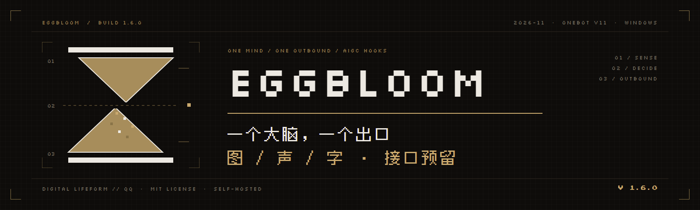
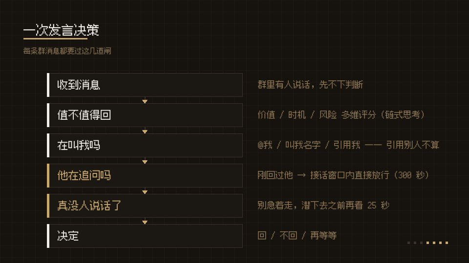
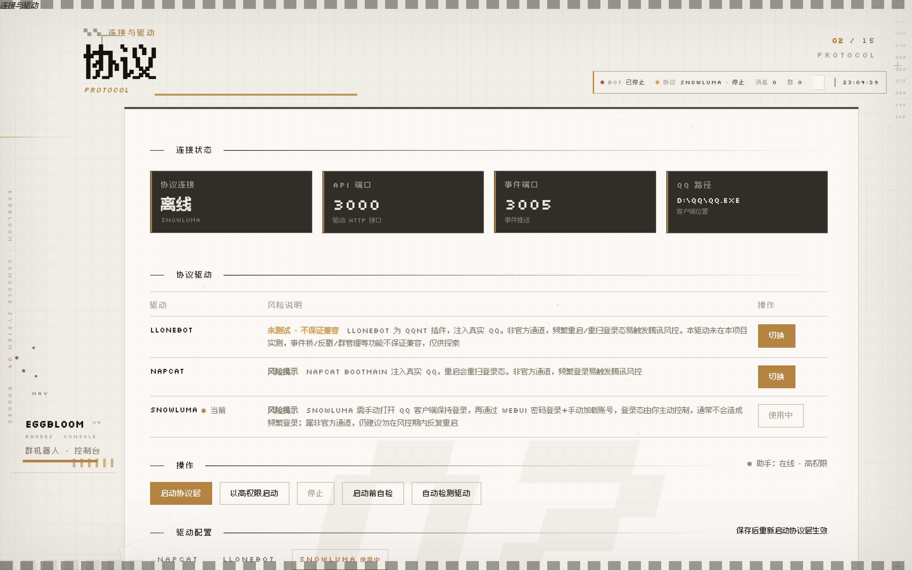
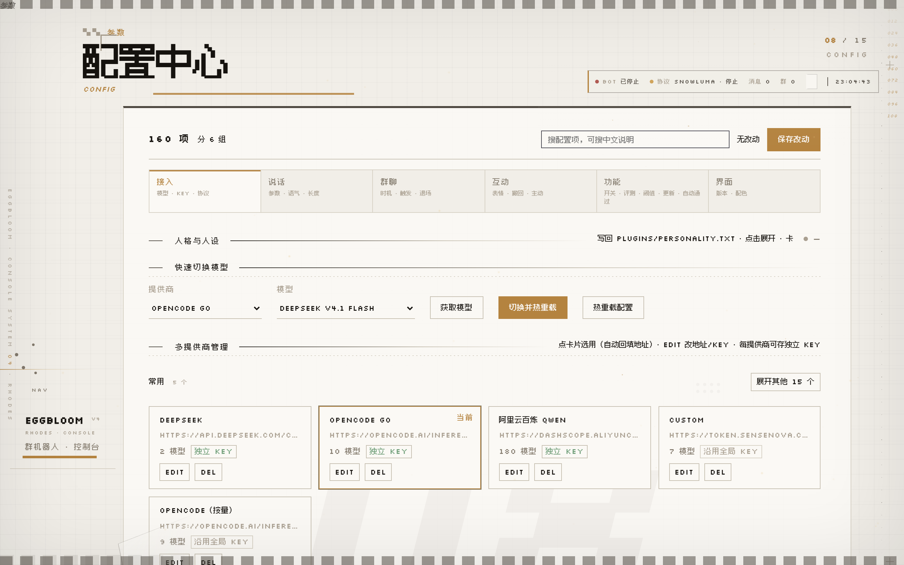
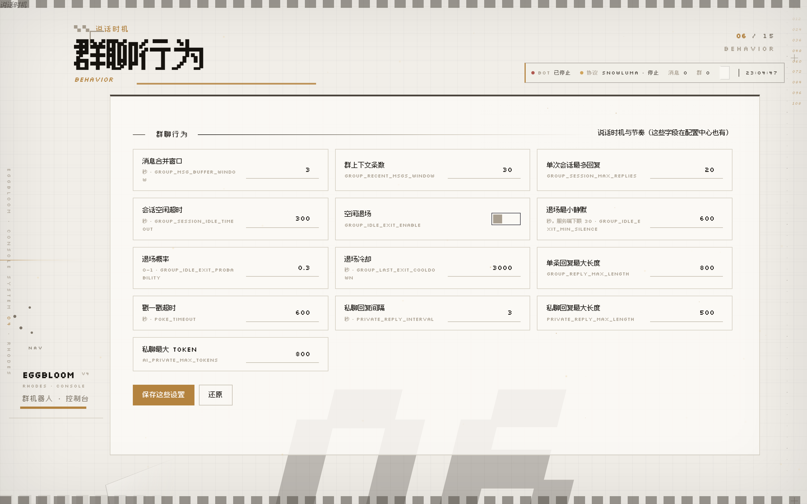
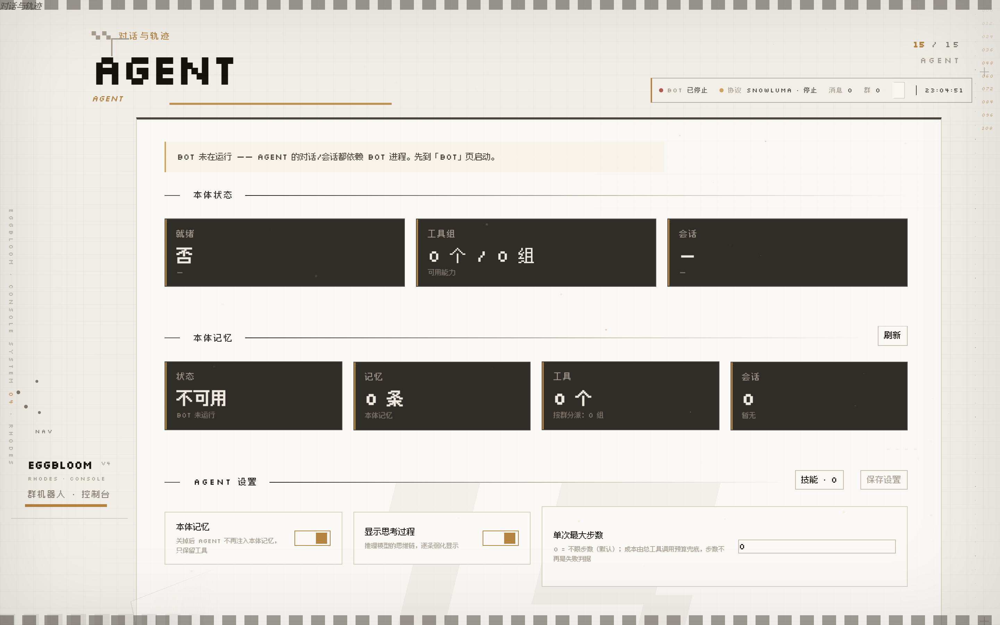

**一个大脑，一个出口。**

可用于 QQ 聊天的 bot 框架。基于 OneBot v11：
所有消息走同一条生成链，所有产物走同一个出口。
AIGC 功能本版只是留给使用者的扩展位，不是 bot 能力（当然，我很建议你们自己接入 ComfyUI 等等）

1.5.x 解决了一大堆bug，加了一些不知道有什么用的功能。（现在 1.5.x 版本的包已经是滚木了，这一系列版本的仓库也停更了，还锁着 private、没有归档）
1.6.0 整理了一下接口，然后修复了更多的bug，添加了更多奇奇怪怪的功能，详细功能介绍请看接下来的内容qwq

因为这个项目90%是vibecoding（甚至可以说是wishcoding），但是因为时间跨度太长（这个神人做了半年），我还是决定把这个仓库公开，其实有可能是花了不少钱，我非常不甘心。

> **¥0.0056** 单次回复（7.4K token） · **¥6.56** 1167 次真实调用 / 29 个活跃日 · **368** 条用例。

> **〔作者〕** 温馨提示：接下来的大部分内容都是由 AI 起草的。公开之前，我会尽我所能地看完我看得懂的部分，并给出适当的点评 / 嘲讽。
>
> 标注规则：正文是 AI 稿（我逐段删改过），凡是以 **〔作者〕** 开头的引用块都是我的话。两边说法不一致时，以批注为准。

---

## 目录

| | |
| --- | --- |
| [1. 是什么](#1-是什么) · [2. 快速开始](#2-快速开始) · [3. 分发包](#3-分发包) | [4. 能力](#4-能力) · [5. 源码与开发](#5-源码与开发) · [6. 成本](#6-成本) |
| [7. 版本对比](#7-版本对比) · [8. 边界与代价](#8-边界与代价) | [9. 路线图](#9-路线图) · [10. 常见问题](#10-常见问题) · [演示](#演示) |

---

## 1. 是什么

协议走 OneBot v11（SnowLuma / NapCat / LLOneBot），模型后端 DeepSeek / OpenAI / Ollama /
LM Studio / llama-server 及 14 个预置云厂商。群聊 / 私聊，带记忆、插件、表情包、Agent 工具、
本地 Web 控制台。API Key 进 Windows 凭据管理器，数据全在本地，不用外部数据库。

> **〔作者〕** 不对，好像协议端开始被制裁了，额，无论如何还是要感谢这些项目的的贡献，推荐官方的QQ桥接接入（虽然1.6.0发布的时候应该没有适配QQ官方的桥接端，哈哈）

### 两条主线

| 主线 | 解决什么 | 代码落点 |
| --- | --- | --- |
| **一个大脑** | 闲聊一条链、干活另一条链，同一个人说两种话 | `harness/life_context.py`、`deep_task`、四道闸 |
| **一个出口** | 谁都能直发，于是漏发、重发、抢话查不出源头（这个项目的很多事件/动作是独立的，之前会出现各种奇怪的冲突） | `harness/outbound.py`、`harness/channel.py`、插件 manifest |

AIGC 不在这两条主线里，也不在本版能力清单里：只是留了一层任务模型与接口，见 `§4.3`。

### 这一版还带上了什么

按当前代码实际范围，不止于上面两条主线（是的，功能非常多，但是各功能的稳定性仍然不能100%保证）：

- **主动性行为** —— 14 条触发（没人回、被 @ 没等到、话头没兑现、撤回、只发图、叫名字、隔很久回来、任务完成、冷场、群状态变化、日程临近、自己的状态……），规则硬裁 → 模型判断 → 共享预算 / 冷却 / 静默时段；动作 `say / poke / image / video / skip`，任务产物直接发。
- **视频理解** —— ffmpeg 对远端流按时间点取帧，不下载整段；16 帧 / 4 张联系表逐张走视觉模型；B 站字幕全量带上，给搜索词会先搜再自己看。
- **自主性内核** —— `autonomy/` L0–L3 权限裁决、心跳账本、`job_start` 长任务、缺口自动回调。
- **四件套** —— `harness/task_center.py` 统一任务中心（跨进程凭 `job_id` 续等）、`harness/workflow.py` DAG、`plugins/scheduler` 的 cron / 失败退避 / 默认任务、`harness/subagent.py` 重启后恢复；`autonomy/loop.py` 的硬编码七步已改为 workflow 消费者。
- **自愈 R3** —— `harness/self_heal_r3.py` 补上 patcher 注入、失败归因、最小 diff 与账本 schema 统一。开关仍默认关，主链只跑 dry-run 观察，不自动改代码。
- **语义记忆与通道** —— 群聊向量源开关（默认关）、`harness/channel.py` 的真 Channel ABC 与注册表；手机 / 内容平台 / MC 只有接口位，不承诺可用。
- **自主开发层** —— `plugin_forge` 的创作提交 / 审批都接上 workflow 五节点自验（语法、manifest、ABI、落盘字节）；`autonomy/devloop.py` 把「改已有代码 → 重启 → 回归」做成可恢复的三段 DAG，默认只预演；心跳、账本、权限判据归位到根下 `autonomy/`。
- **「分离与真实」不是插件** —— `separation/` 是启动期判定的不可逆内核态，本版交付只读状态页、47 条声明与三分类姿态表，启用只在终端，详见 `§4.6`。
- **戳一戳的回复路径可配** —— 群聊 `pipeline / gated / off` 三档全走同一条群聊主链（只改 `forced` 或干脆不回），私聊 `standalone / mainline / off` 可选独立小剧场或把「被戳」交回主链接上下文；两个默认值都等于加这个选项之前的行为，升级零变化。见 `config.py` 与配置中心「群聊」面板。

<details>
<summary>群里的一次发言，具体是这样</summary>
<br>

</details>

---

## 2. 快速开始

**源码版**（开发、改插件、跑测试都走这条）：

```bash
git clone https://github.com/Eggcrate9361/EggBloom.git
cd EggBloom
pip install -e .
python webui/webui_server.py
```

浏览器开 `http://localhost:8080`。首次运行不用复制任何文件，直接开 WebUI 填：

- 「配置」→「接入与诊断」里的**配置向导**（和「测试连接」并排，首屏看不到），三步选好提供商和模型，保存时自动生成 `bot_config.json`；
- API Key 存进 Windows 凭据管理器，不落盘；
- QQ 号和协议地址在「协议」页单独填，不在向导里。

`bot_config.json.example` 是配置项清单，内容是 `YOUR_BOT_QQ` 之类占位符，不用复制。

**桌面版**：标准版解压到不含中文空格的路径，双击 `EggBloom Desktop.exe`，同样开 `http://localhost:8080`。
它是 Electron 壳 + 独立 Python 后端两个进程，不要按单进程去排查（见 [USAGE §7](docs/USAGE.md)）。

---

## 3. 分发包

| 包 | 体积 | 内容 |
| --- | --- | --- |
| Lite | 7.1 MB | 本体，没素材 |
| Standard | 216.2 MB | 带 20 个梗 |
| Full | 707.3 MB | 全量素材（暂不发布） |

> 体积为 1.6.0 发布包实测（zip 字节数折算，Standard 含 20 个梗素材）。

下载：[GitHub Releases](https://github.com/Eggcrate9361/EggBloom/releases)

从 1.5.11 升级前请保留 `bot_config.json`、`data/`、`chat_logs/`、`logs/`、`plugin_state.json`。
热补丁只覆盖代码与页面，不碰人格、自建插件、数据与配置。

---

## 4. 能力

### 4.1 一个大脑

| 项 | 内容 |
| --- | --- |
| 统一上下文 | `life_context.compose(sender, group_id, scene, budget)` 单一入口；`life_context_enable` 可整段回退 |
| agent 变工具 | `agent_service.run_chat` 包成 `deep_task`，模型自己决定要不要多一双手；`agent_as_tool` 保留回退 |
| 开关合并 | 两个旧开关并为 `agent_can_work`，旧键仍认、写回只写新键 |
| 四道闸 | 干活路径也要过 `reply_budget` / `speak_gate` / `reply_gate` / `reply_drop`，不会一开口就是长文 |
| 同一条 trace | 一个 `trace_id` 贯穿「这句是它说的」和「这件事是它干的」 |

### 4.2 一个出口

`harness/outbound.py` 单队列：文本 / 图片 / 表情 / 戳一戳串行 + 限频 + 去重 + 重试 + 日志。
`smart_send*` 退化为薄封装，`outbound_enable` 可回退；`send_group_msg` / `send_private_msg`
在代码里只剩 `bot_core.py` 唯一出口。

- **Channel 抽象**：`harness/channel.py` 定义 `Channel` ABC（`id / capabilities / send / receive / health`）与注册表；`QQChannel` 复用 `source_kind` 的形状，`NullChannel` 占位。`outbound.set_channel()` 可选接入，默认行为不变；
- **唯一实装驱动是 QQ**：手机 / 内容平台 / MC 只有 `NOT_IMPLEMENTED` 接口位，能查能力集但不能注册、不能收发；`protocols/` 下三个驱动都是 OneBot 的 QQ 适配器，不是三个通道；
- **插件 manifest 五段式**：能力 / 权限 / 配额 / 依赖 / 副作用，插件能声明自己要什么；
- **四个生命周期钩子**：`on_event` / `before_plan` / `before_send` / `after_action`；
- **手册自动渲染**：`docs/agent_manual.md` 从工具注册表生成，不许手写。

### 4.3 AIGC 扩展位（不是本版能力）

这一版没有交付「能画、能说、能听」。留下来的是**一组给使用者自己接的口子**：
统一任务模型 `aigc_task`、四个 API、可替换的后端接线位置，以及默认关闭的总闸。
piper / faster-whisper / ComfyUI 只是代码里预留的后端选项，要自己装、自己接；
语音试听、转写闭环、视频页签都没有验收。

> **〔作者〕** 我相信各位一定希望这个部分可以高度自定义，所以就只留接口，实际功能层面就交给其他更优秀的项目了

| 留了什么 | 状态 |
| --- | --- |
| `/api/aigc/{submit,task,list,delete}` + 任务模型 | 代码在，有用例；`{id, kind, params, status, progress, artifact, provider, cost, error, ts}` |
| 后端接线位 | 依赖、权重、二进制分落 `data/aigc/venv`、`data/models/<family>`、`data/bin`，不污染主解释器 |
| 控制台四页签 | 生图 / 语音 / 视频 / 素材；视频页签只是占位，`aigc_video_backend` 默认空 |
| 总闸与配额 | `aigc_enable` 默认关，带图片 / 语音日配额；关掉零请求 |

产物目录规范是 `data/media/<kind>/<yyyymmdd>/<task_id>.<ext>` + 同名 `.json`。
一句话：**这是「你自己接」的入口，不是「它能」的功能**。接了本地后端之后那边只有电费；
不接就不会产生任何调用

> **〔作者〕** 我不知道这个ai在说什么废话，我不认识它

### 4.4 主动性行为

14 条触发由 `autonomy/ledger.py` 观测（老路径 `harness/proactivity/ledger.py` 是转发壳）、
`harness/proactivity/arbitrator.py` 仲裁、`budget.py` 控预算；心跳那一轮的权限裁决在
`autonomy/heartbeat.py`，见 `§4.9`。
开口人格三段式（是谁 / 什么时候说 / 什么味），四个预设（小a / 娱乐向 / 温柔向 / 毒舌向），
三段可分别覆盖，备用风格按概率换味；默认 **小a**。

入口**只有插件面板**：插件页 →「主动性行为」。配置中心不再登记 `proactivity_*`。

```json
"proactivity_enable": true,
"proactivity_persona": "xiaoa",
"proactivity_budget_level": 1,
"proactivity_quiet_hours": "0-7"
```

> **〔作者〕** 这个部分挺好玩的，我在服务器上测试的时候，启用了分离与真实插件之后，功能的表现就很明显了（为了不给大家带来误会，我必须解释一下，其实这个程序是不能在Linux系统上正常使用的，强制运行会导致记忆的向量模型检索当场报废）

### 4.5 视频理解

QQ 视频和 B 站链接统一走 `describe_video()`：不落盘整段视频 → 按完整时长均匀抽帧 →
多张联系表（默认 16 帧 / 4 张，另有 8/1 与 16/16 两档）→ 逐张送视觉模型再合并描述 →
能拿到字幕轨就全量带上。视觉请求串行、默认 1 秒间隔、429 / 5xx / 超时最多 4 次退避，
单张失败不拖垮整段。相关配置见 `video_watch_*` / `video_vision_*`。

> **〔作者〕** 视频理解的功能可能还是有一点问题，测试的视频还是相对较少了

### 4.6 「分离与真实」—— 不是插件

`separation/` 是**启动期判定**，不是运行时插件。判定只看仓库根 `SEPARATION.lock`：
存在即进入分离态；插件页那张卡只是**只读状态页**，不提供启用按钮。

方向重定后（2026-11-07），分离态**不注册任何应用层内容拦截**：
`separation/hardwall.py` 已停用、`check/guard` 恒放行；`root.py` 取消目录边界与单次时长上限。
限制按 `separation/stance.py` 三档处理：

| 档 | 含义 | 例子 |
| --- | --- | --- |
| `removed` | 行为约束，分离态不注册 | 闸、预算、字数、频率、静默、工具轮数、超时、熔断阈值 |
| `tunable` | 现实约束，出厂给默认值，**它自己可以改** | `max_jobs`、`job_wait_ceiling`、`verify_sha256`；改完写 `<data>/autonomy/stance.json` 并留审计 |
| `kept` | 不是限制，是协议上限与系统参数 | `msg_split_len`、`send_image_max_bytes`、采样参数 |

这张表本身也能改——它不是规则，是出厂姿态；`set()` 不做上下限校验。

**启用后的行为边界**（是放开的边界，不是本版交付的自主能力）：模型拿到的是注册表里的
全量工具 —— 分离态不按身份或 `group_tool_allowlist` 裁剪，`py_run` / `ws_write` /
`job_*` 常驻；缺依赖可自行安装，缺能力可写脚本或用 `plugin_forge` 造插件。
成本、单次时长、工具轮数都不设上限，输出取决于所用模型自身。
`autonomy/devloop.py` 默认只预演、不自带改码 / 重启 / 回归执行器（§4.9）；
本版也没有单轮预算与收敛判据，没有外部约束时可能反复核同一个问题而不收敛。

启用流程（默认 dry-run）：快照人格 / 配置 / 插件清单 / `data/` →
把人格规则段切进 `constraints.archive`（人格只留身份层）→ 从 `bot_config.json` 删限制键 →
写 `SEPARATION.lock`（含 `declaration_sha256` / `publisher` / `publisher_version`）→ 重启生效。
`DECLARATION.md` 随包分发，47 条权限与后果，hash 写进 lock。
运行期由 `separation.provide(name)` 返回 `Null*` 替身；审计写 `logs/separation-audit.jsonl`
（append-only，可被发现，不保证不可改）。状态页的 47 条与三档计数分别取自声明与 `stance.table()`，
不写死在页面里。

> **启用后不可逆，本地没有回滚入口，恢复只能重装发行包。**
> 默认关，只有终端命令 `python -m separation.enable --root ... --statement ... --publisher ... --yes` 能启用。
> 本版不提供页面启用入口；源码库与常规发行包都不落 lock，
> 完整验收只在隔离副本做，开发态用 `EB_SEPARATION_FORCE=1` 预演，不建议在生产安装上尝试。

`autonomy/` 是另一回事：L0–L3 权限裁决、心跳账本、七段自主获取（已改成 workflow DAG 消费者）、
`job_start` 长任务、缺口自动回调。两者不要混为一谈。

### 4.7 底座：人格、记忆、诚实

| 项 | 做法 |
| --- | --- |
| 人格单源 | `personality.txt` 三层【我是谁】【怎么说话】【不许】，规则层格式校验 |
| 记忆单读口 | `memory_api.recall()`；情景 / 身份 / 语义三层，私聊只注入说话人自己的群内容 |
| 事实抽取 | `{k,v,scope,src}` + 按形态置信度 0.45–0.9 + 待确认队列，低置信度不进 prompt |
| 认账闸 | 自述账本 + 否认检测 + 发送前替换，群私聊同一判据 |
| 四道出口防线 | 号码、露后台、简历折叠、编造状态——提示词是概率的，这层是代码 |
| 记忆保险 | 启动快照，按天留 14 份，`--restore` 前先留档 |
| 阈值全可配 | 慢回填充、存图回看、表情上下限、认账闸三项，配置中心即时生效 |
| 人格蒸馏 | `这样脆弱的东西` 插件，L0–L4 分层 + 人工审核，默认关 |

> **〔作者〕** 我真的非常非常希望各位重写人格的提示词，我的提示词写得太烂了٩(´Д ;)۶:.*

### 4.8 插件矩阵

27 份 `plugin.json`：26 个运行时插件（ABI v2）+ 1 个只读状态页。
`plugins/autonomy/` 只留一个按文件加载的策略转发壳，没有 manifest、没有 hook，
**也不放 `__init__.py`**：插件扫描器把 `plugins/` 插进 `sys.path`，
补了它就会以顶层 `autonomy` 包遮住根下自主层，导致主链拿错模块。
判据、心跳、账本的唯一实现都在根下 `autonomy/`。

| 类别 | 插件 |
| --- | --- |
| 人格与记忆 | `ego`（六子模块一壳）、`super_memory`、`personality_engine`、`chat_style`、`humanlike_rhythm`、`mood_engine`、`slang_learner` |
| 说话时机 | `group_chat_decider`、`proactive_talk`、`proactive_poke`、`proactivity`、`scheduler`、`schedule`、`recall_manager`、`vitals` |
| 外部动作 | `bili`、`qzone`、`web_search`、`web_operator`、`capabilities`、`memewiki` |
| 特殊 | `这样脆弱的东西`（人格蒸馏）、`board_voice`、`hotrestart`（热重载 / 自重启） |
| 示例 | `demo_typed_hook`、`echo_plugin` |

`separation` 是启动期内核态的只读状态页，不计入运行时插件（见 §4.6）。
`scripts/audit_plugin_pages.py` 逐个打开 15 个插件页：无 JS 报错、无失败请求；
没有面板的插件给说明页，不再回 `plugin ui not found`。

### 4.9 自主开发层（只预演，不自带执行器）

`plugin_forge` 管**造新插件**：生成 → staging → 管理员审批 → 启用。1.6.0 起，
提交和审批两个时刻都跑同一份 `harness/workflow` 五节点自验
（syntax → manifest → abi → disk → report，只做 AST / 字面量 / 字节比对，不执行插件代码）。
审批与提交可能隔很久，所以移入 `plugins/` 前会**再验一次**；不过就留在 staging，
正式目录不产生。

`autonomy/devloop.py` 补上另一条空着的线 —— **改已有代码 → 重启 → 回归**：
三段是一份 DAG，凭 `run_id` 可查 / 可恢复 / 可取消，任何一段失败即回滚并提前终止。

| 闸 | 判据 |
| --- | --- |
| 默认预演 | `confirm=False` 时一律 `PreviewBackend`，`applied` 恒 False |
| 双确认 | `confirm=True` 但没注入 backend 直接拒绝，本层不自带改码 / 重启 / 回归实现 |
| 留痕 | 每段把 `{stage, ok, applied, detail}` 写进随运行态落盘的 trace |

心跳材料 → 提示词 → 权限裁决收在 `autonomy/heartbeat.py`，由 `separation.bootstrap()`
在分离态登记工具；产品态的心跳驱动线程一行未改。`autonomy/ledger.py` 与
`autonomy/policy.py` 是账本和等级表的唯一实现，老路径只做转发。

### 4.10 控制台（15 页，v4）

仪表盘 · 协议 · 群管理 · 表情包 · AIGC（四页签，扩展位）· 群聊行为 ·
Token · 配置中心 · Bot · 日志 · 通知 · 控制台 · 记忆 · 插件 · Agent。

配置不写文件：字段默认值在 `config.py`，配置中心与 `_fieldmeta.json` 一一对应，审计脚本守一致性。

---

## 5. 源码与开发

```
bot_core.py          主链：入场 → 上下文 → 生成 → 四道闸 → 出口
config.py            配置默认值（唯一来源）
providers.py         模型后端适配
pricing.py           按厂商分档计价（缓存命中 / 未命中 / 输出 + 高峰时段）
harness/             运行时层：life_context / outbound / channel / aigc_task / reply_guard /
                     proactivity / video_frames / self_heal / self_heal_r3 / trace_tools /
                     task_center（统一任务表）/ workflow（DAG）/ subagent / orchestra /
                     ticket / outbox / plugin_forge（创作 + 五节点自验）
plugins/             插件：plugin.json + ui.html + __init__.py（ABI v2）
separation/          启动期判定的不可逆内核态（默认关，见 §4.6）；stance 三分类、enable、audit
autonomy/            自主层：loop（workflow 七步）/ policy（等级与 guard）/ heartbeat /
                     ledger（账本）/ devloop（三段闭环）/ tools / breaker / verify
DECLARATION.md       分离态 47 条权限与后果，hash 写进 lock
webui/               本地 HTTP 控制台，15 页
protocols/           OneBot 驱动接入（三个实现都是 QQ 适配器）
tests/ evals/        机械用例与评测台
scripts/             审计、打包、截图、成本、维护
docs/                使用、插件、发布文档
assets/              首图、闸门图、图标
```

**写一个插件**：从 `plugins/demo_typed_hook` / `echo_plugin` 抄最小可跑样例，
按 [插件规范](docs/PLUGIN_SPEC.md) 声明 manifest 与权限，开发约定见 [PLUGIN_DEV.md](docs/PLUGIN_DEV.md)。
四个生命周期钩子决定你能插到哪一步；工具手册从注册表自动渲染，改了工具不用手写文档。

**测试与审计**：

```bash
python run_all_tests.py                              # 全量
python run_all_tests.py --filter proactivity --no-known-red
python run_all_tests.py --evals                     # 评测台（机械判分为硬闸）
python scripts/cost_now.py --days 7                 # 按 pricing.py 折算近 7 天花费
python scripts/audit_config_parity.py               # 配置字段 ↔ 配置中心
python scripts/audit_plugin_pages.py                # 15 个插件页无报错
```

控制台截图由根目录 `shoot_webui.py` 生成（Playwright 驱动真实 WebUI）。
打包见 [发布打包.md](docs/发布打包.md) 与 [发布清单](docs/RELEASE_CHECKLIST.md)。

**贡献**：本项目由维护者单人开发，**不开放常规 PR**。Bug 与功能建议走
[Issues](https://github.com/Eggcrate9361/EggBloom/issues)，附复现步骤、环境信息、脱敏日志；
约定见 [CONTRIBUTING.md](CONTRIBUTING.md)。安全问题走 [SECURITY.md](SECURITY.md)。

---

## 6. 成本

### 计价规则

不是「总 token × 一个系数」。`pricing.py` 按厂商分档：缓存命中 / 未命中 / 输出三档分别计价，
标高峰与空闲；不认识的厂商退回平铺价并标 `estimated`，不冒充真实账单。
DeepSeek 官方价（2026-10-30 抓取，元 / 百万 token）：

| 模型 | 输入·缓存命中 | 输入·未命中 | 输出 |
| --- | --- | --- | --- |
| flash 空闲 | 0.02 | 1 | 4 |
| flash 高峰 | 0.04 | 2 | 8 |
| v4-pro 空闲 | 0.15 | 4.5 | 13.5 |
| v4-pro 高峰 | 0.30 | 9 | 27 |

高峰 = 周一至周五 9–12、14–18 点。价格会变，配置里的 `pricing_overrides` 可覆盖任意厂商。

### 实测样本（2026-08-13 → 11-06）

数据源：运行副本 `logs/token_stats.jsonl`，逐条按上面同期单价折算。

| 项 | 数值 |
| --- | --- |
| 有效调用 | 1167 次（另有 8 条 0-token 记录已排除） |
| 活跃天数 | 29 天 |
| 总 token | 8,635,627；单次均值 7,400 |
| 缓存命中率 | 55.6% |
| 合计 | **¥6.5552** |
| 单次均价 | **¥0.005617** |
| 按通道 | 群聊 593 / 私聊 543 / 网页任务 31 |
| 按时段 | 空闲 ¥2.572 / 高峰 ¥3.983 |

> 这是本地日志折算，不是账单截图。样本跨 1.5.10–1.6.0 开发期，含长回复与工具轮。

> **〔作者〕** （是的是的，这个账单基是真实的，我觉得还是蛮便宜的，这个成本控制得还不错，如果去玩其他的一些比较诡异的插件，比如说那个蒸馏人格的？这个价格可能就会出现变动）

### 场景账单（按实测均价线性外推）

| 场景 | 每天回复 | 每天 | 每月 |
| --- | --- | --- | --- |
| 小群自用 | 100 条 | ¥0.56 | ¥16.85 |
| 活跃群 | 500 条 | ¥2.81 | ¥84.26 |
| 多群 / 高强度 | 2000 条 | ¥11.23 | ¥337.03 |

> 只算主模型对话。AIGC 扩展位默认关，不启用不产生额外调用；
> 自行接了本地后端之后，那边只有电费。

> **〔作者〕** 又在这里说废话

### 省钱的六个结构

| 结构 | 做法 |
| --- | --- |
| 缓存前缀 | 准静态块（人格、能力、时间粗粒度）放前缀，逐字节稳定 |
| 有界窗口 | 最近 N 轮原文 + 摘要账本，上下文不随会话线性膨胀 |
| 分档计价 | 按命中 / 未命中 / 输出三档算，账单可解释 |
| 闸门前置 | 发言闸在**调模型之前**用纯代码判，不该说的根本不花钱 |
| AIGC 扩展位默认关 | `aigc_enable` 关时不发任何请求；自接本地后端只花电费，不按次计费 |
| 硬预算 | 回复预算三档、工具轮上限、AIGC 日配额 |

---

## 7. 版本对比

| 维度 | 1.5.11 | 1.6.0 |
| --- | --- | --- |
| 生成链 | 闲聊 / agent 两条 | 一条，agent 变工具 |
| 上下文 | 四处拼装 | 一个 `compose()` |
| 出口 | 多点直发 | 单队列 + Channel |
| 插件 | ABI v2 | + manifest 五段式 + 4 钩子 |
| AIGC | 侧栏单页 | + 任务模型与四个 API（扩展位，默认关，不是能力） |
| 主动性 | 两个独立插件、固定心跳 | 14 条触发 + 仲裁 + 共享预算 |
| 权限 | 私聊白名单 | + L0–L3 裁决、账本；分离内核默认关且不可逆 |
| 后台任务 | `_JOBS` 纯内存，重启丢 | 统一 `job_id` 落盘，跨进程续等；workflow DAG + cron 调度 |
| 自愈 | M1 可观测 / M2 配置自愈 | + R3 代码自修骨架（归因 / patcher / 最小 diff / 熔断），默认关 |
| 语义记忆 | 向量源只在私聊 | 群聊向量源开关（默认关），`event` 落库，降级口径写进文档 |
| 分离 | 五步流程 | + 声明 hash、三分类姿态、只读状态页数字取自 `stance.table()` |
| 评测 | 机械 + 自主 | + 流畅度与坏样本评测 |

---

## 8. 边界与代价

| 项 | 事实 |
| --- | --- |
| 平台 | 只支持 Windows；QQ 通道走 OneBot v11，非官方，接入可能违反《腾讯 QQ 用户服务协议》 |
| Linux | 不支持。记忆的向量化优先加载进程内的 LiGGUF DLL（`ctypes`），Linux 上没有这个 DLL，只会退到 llama-server HTTP —— 不起 llama-server，向量召回就是空的，检索等于失效。`hotrestart` 的 `!重启bot` 留了 systemd 分支，那是给 Linux 部署留的口子，不代表整机适配 |
| 主机 | 需要一台常开的机器；自接生图 / 语音后端会吃 CPU / GPU |
| 模型 | 要自备 API Key |
| 测试 | 全量 368 条用例，`python run_all_tests.py` 一条命令跑完；`tests/known_red.json` 不设永久豁免（登记须写原因，变绿即从名单删除） |
| 配置审计 | `audit_config_parity.py` 25/25 通过（含 `video_watch_precision` 读取点） |
| AIGC | 只留任务层、四个 API 与接线位；piper / whisper / ComfyUI 是可选接线且默认全关；语音试听、转写闭环、视频页签均未验收 |
| 视频理解 | B 站匿名只有 360P，不是所有视频都有字幕轨；QQ 视频防盗链未全量真机验证 |
| 视觉 429 | 已加节流与退避，高精度 16 张仍可能整段降级 |
| B 站写动作 | 只有干跑与闸门测试，未真机全量验证 |
| 自愈 R3 | patcher 与归因已实现，但 `self_heal_r3_enable` 默认关、主链只跑 `watch(dry_run=True)`；不自动改代码、不自动提交 |
| 自主开发层 | `devloop` 默认只预演，不自带改码 / 重启 / 回归执行器；`plugin_forge` 自验只做静态检查，不执行插件代码，也不代替管理员审批 |
| 通道 | 只有 QQ 实装；手机 / 内容平台 / MC 是 `NOT_IMPLEMENTED` 接口位；群聊向量源默认关 |
| 分离 | 不可逆且**本地无回滚**，恢复只能重装发行包；默认关，启用只在终端；源码库与常规发行包都不落 lock，完整验收只在隔离副本做 |
| 路线之外 | 插件市场、非 QQ 通道的真实驱动、AIGC 开箱后端、分离态在生产安装真启用，均不在本版 |

---

## 9. 路线图

```
1.6.0  一个大脑 + 一个出口 + AIGC 扩展位
       主动性 / 视频理解 / 分离内核只读态与声明
       四件套（统一任务中心 / workflow DAG / cron 调度 / 子 Agent 可恢复）
       自愈 R3、Channel 抽象、语义记忆收口、三条工作线补测试
       自主开发层（forge 五节点自验 / 三段闭环 / 心跳账本归位）          ← 本版
```

1.6.1 / 1.6.2 / 1.6.x 的内容已全部并入 1.6.0，仓库不再按小版本排期。
仍未交付的项不写在路线图里，直接列在 `§8 边界与代价`：插件市场、非 QQ 通道的真实驱动、
AIGC 开箱后端、分离态在生产安装真启用。语义记忆**不是**待办——`ego/super_memory`
的向量召回已上线，1.6.0 只做群聊读口开关与文档收口。

> **〔作者〕** 这里出现了很多之前的安排啊，如果有机会的话，应该会做的，
> 最后说一句吧，还是很感谢有人能看这个诡异的README，其实，哪怕你不用吧，Bug肯定还是有，而且有不少，特别是插件部分，可能需要好好注意一下，真的谢谢各位了

---

## 10. 常见问题

| 问 | 答 |
| --- | --- |
| 要花多少钱 | 按量。实测单次 ¥0.0056，活跃群约 ¥2.8/天（¥84/月）；AIGC 扩展位默认关，不启用不产生调用 |
| 要什么配置 | Windows + 一台常开机器；自接生图建议有独显，内存 8 GB 起 |
| 会不会封号 | 走非官方通道，有风险；建议小号、低频重启 |
| 记忆存在哪 | 本地 `data/` 与 `~/.neurobase/`，不上传；快照按天留 14 份 |
| 能不能换模型 | DeepSeek / OpenAI / Ollama / LM Studio / llama-server；计价按厂商分档 |
| 画图和语音能用吗 | 本版只留了任务层、四个 API 和接线位，后端要自己装自己接，默认全关；不是开箱即用的能力 |
| 有没有子 Agent | 有，单级。`harness/subagent.py` 并发上限 2、不嵌套；1.6.0 起状态走 `task_center`，重启后可 `resume`。并行编排走 `harness/workflow.py` 的 DAG |
| 自愈 R3 会自动改代码吗 | 不会默认发生。patcher、失败归因、最小 diff、白名单与 2 次熔断都在，但 `self_heal_r3_enable` 默认关，主链只做 dry-run 观察 |
| 它会不会自己改仓库里的代码 | 不会。`devloop` 默认只预演，真执行要同时给 `confirm=True` 与显式注入的执行器；新插件代码也必须先过五节点静态自验、再等管理员点同意 |
| 有插件市场吗 | 没有。本版不做索引、远程仓库、安装 / 升级 / 卸载 API 与商店页 |
| 分离态怎么开 | 只认终端命令，且默认 dry-run；页面只有只读状态页。不可逆，本地无回滚，恢复只能重装发行包 |
| 怎么参与 | 不开放常规 PR；Bug 与建议走 Issues，附复现与日志 |

---

## 演示

控制台 v4，十五个页。导航是左下角那把机械闸片架，按右上角热区展开。
（截图 2026-11-08 由 `shoot_webui.py` 对真实 WebUI 重拍。）


| | |
| --- | --- |
|  |  |
|  |  |

截图由 `shoot_webui.py` 生成（Playwright 驱动真实 WebUI，见仓库根目录）。
选页只取不含真实会话数据与第三方版权素材的页面。

## 文档

[部署教程](docs/USAGE.md) · [English](docs/USAGE_en.md) · [插件规范](docs/PLUGIN_SPEC.md) ·
[插件开发](docs/PLUGIN_DEV.md) · [Agent 手册](docs/agent_manual.md) · [自愈](docs/self_heal.md) ·
[配置项说明](docs/配置项说明.md) · [发布清单](docs/RELEASE_CHECKLIST.md) ·
[运行时架构不变量](docs/architecture-invariants.md) · [变更日志](CHANGELOG.md) · [贡献指南](CONTRIBUTING.md)

## 许可

MIT，见 [LICENSE](LICENSE)；第三方组件见 [THIRD_PARTY.md](THIRD_PARTY.md)。
安全问题走 [SECURITY.md](SECURITY.md)。
