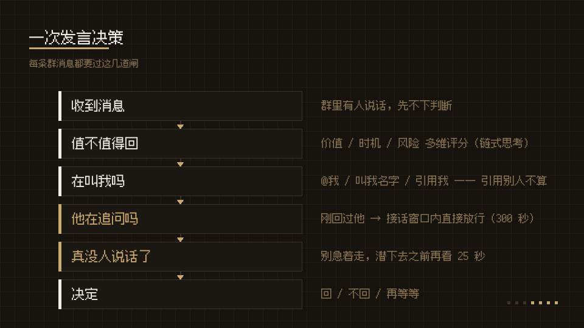
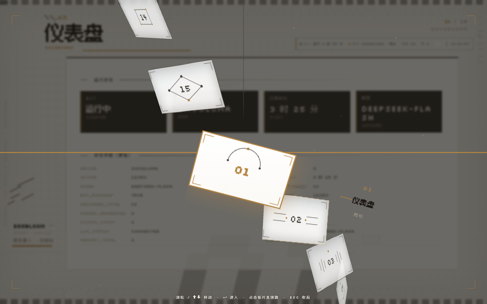
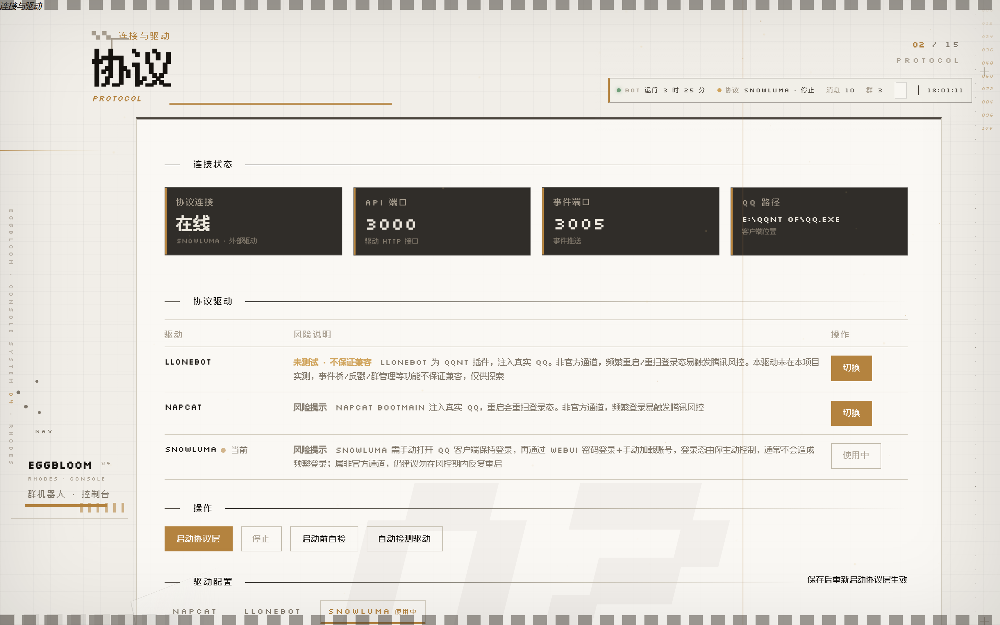
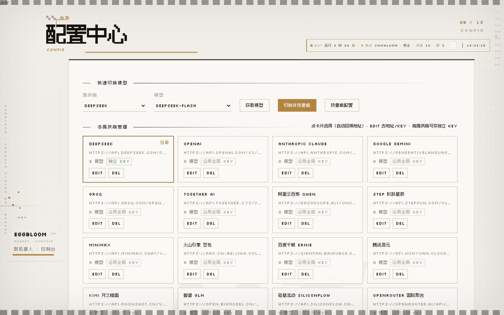
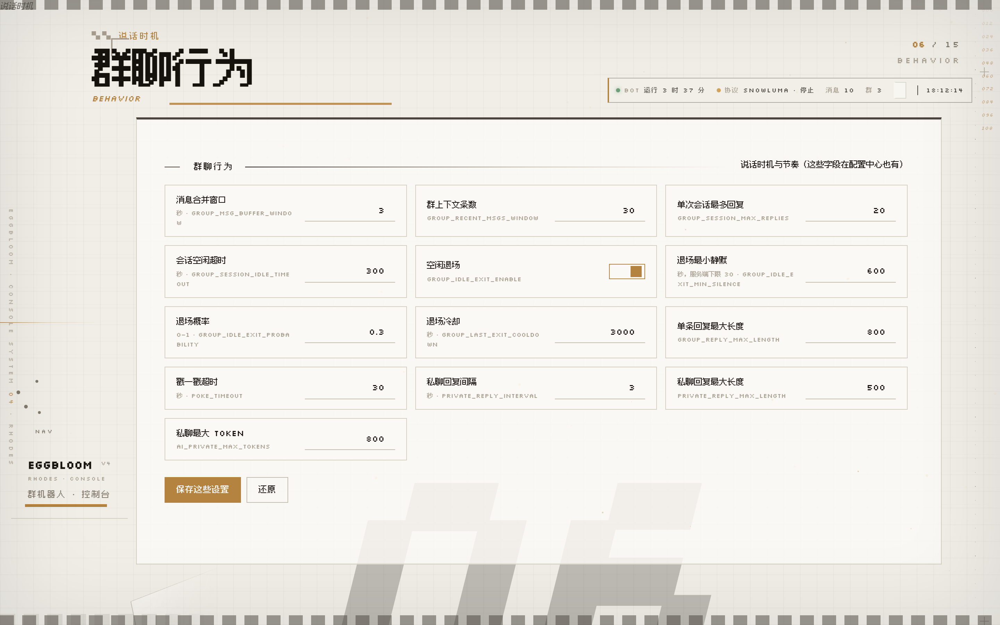
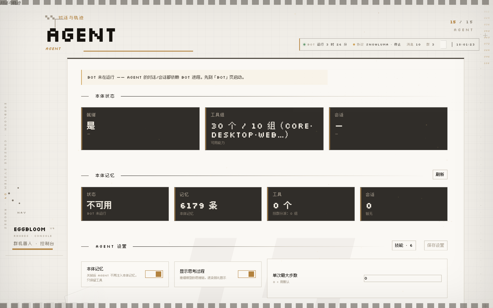

<table bgcolor="#16130F" width="100%" cellpadding="0" cellspacing="0" border="0">
<tr><td align="center" style="padding:40px 16px 36px 16px">

<br><br>

<span style="color:#F0EEEA;font-size:15px">可用于 QQ 聊天的 bot 框架</span>

<br><br>

<a href="docs/USAGE.md"></a>
<a href="docs/USAGE_en.md"></a>
<a href="CHANGELOG.md"></a>

</td></tr></table>

<p align="center">


</p>

---

## 是什么

可用于 QQ 聊天的 bot 框架。基于 OneBot v11，支持 SnowLuma / NapCat / LLOneBot。

模型后端 DeepSeek / OpenAI / Ollama / LM Studio / llama-server。
群聊 / 私聊，带记忆、插件、表情包和 Agent 工具。WebUI 配置，不用装外部数据库。

<details>
<summary>群里的一次发言，具体是这样</summary>
<br>

</details>

---

## 🚀 快速开始

标准版解压到不含中文空格的路径，双击 `EggBloom Desktop.exe`，浏览器开 `http://localhost:8080`。

源码版：

```bash
git clone https://github.com/Eggcrate9361/EggBloom.git
cd EggBloom && pip install -e . && python webui/webui_server.py
```

首次运行不用复制文件，直接开 WebUI 填。「配置」页的「接入与诊断」里有**配置向导**按钮
（和「测试连接」并排，首屏看不到），三步选好提供商和模型，保存时自动生成 `bot_config.json`。
API Key 存进 Windows 凭据管理器，不落盘。QQ 号和协议地址在「协议」页单独填，不在向导里。

`bot_config.json.example` 是配置项清单，内容为 `YOUR_BOT_QQ` 之类占位符，不用复制。

## 📦 分发包

| 包 | 体积 | 内容 |
| --- | --- | --- |
| Lite | 6.2 MB | 本体，没素材 |
| Standard | 215.8 MB | 带 20 个梗 |
| Full | 706.9 MB | 全量素材（暂不发布） |

下载：[GitHub Releases](https://github.com/Eggcrate9361/EggBloom/releases)

## 📚 文档

[部署教程](docs/USAGE.md) · [English](docs/USAGE_en.md) · [插件规范](docs/PLUGIN_SPEC.md) · [发布清单](docs/RELEASE_CHECKLIST.md)

---

## 注意

- 接入 QQ 可能违反《腾讯 QQ 用户服务协议》
- 模型按量计费，群越活跃花得越多

## 演示

控制台 v4，十五个页。导航是左下角那把机械闸片架，按右上角热区展开。



| | |
| --- | --- |
|  |  |
|  |  |

截图由 `shoot_webui.py` 生成（Playwright 驱动真实 WebUI，见仓库根目录）。

## 许可

MIT，见 [LICENSE](LICENSE)。安全问题走 [SECURITY.md](SECURITY.md)。
