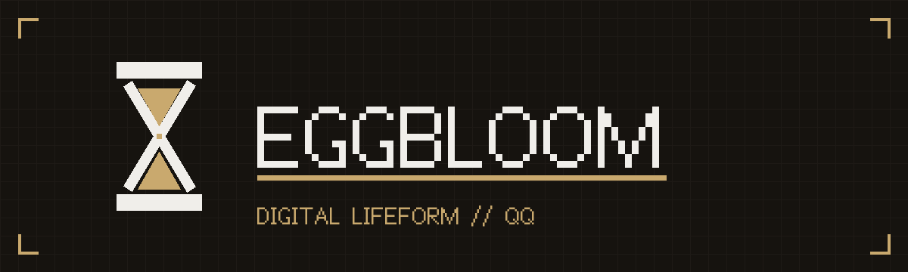

<table bgcolor="#16130F" width="100%" cellpadding="0" cellspacing="0" border="0">
<tr><td align="center" style="padding:40px 16px 36px 16px">

<br><br>

<span style="color:#F0EEEA;font-size:15px">会看群情、挑时机说话、有记忆、也有人格的 QQ 数字生命体。</span><br>
<span style="color:#8A7350;font-size:12px">She reads the room, picks her moments, remembers — and stays awkwardly human.</span>

<br><br>

<a href="https://github.com/Eggcrate9361/EggBloom/releases"></a>
<a href="docs/USAGE.md"></a>
<a href="docs/USAGE_en.md"></a>
<a href="https://github.com/Eggcrate9361/EggBloom/releases"></a>

</td></tr></table>

<p align="center">


</p>

---

## 这是什么

跑在 QQ 群里的 AI 桌面助手。基于 OneBot v11 协议，支持多种协议驱动（SnowLuma / NapCat / LLOneBot），
内置 DeepSeek / Ollama / llama.cpp 多模型后端，提供群聊 / 私聊 AI、情绪状态机、分层记忆、群聊决策、
联系人管理、AI Agent 对话台与 WebUI 管理面板。

**它和别的机器人有什么区别**：群聊里它不抢话——该沉默时沉默，该接梗时接梗，引用能分清「引用我」和
「引用别人」，记得住你说过的话，也有嘴笨和不在状态的时候。

## 功能

| 功能 | 说明 |
|------|------|
| AI 对话 | 群聊 + 私聊，多模型后端（DeepSeek / OpenAI / Ollama / LM Studio / llama-server） |
| 群聊决策 | AI 链式思考 + 多维评分（价值 / 时机 / 风险）决定是否发言，支持图片理解 |
| 图片理解 | 图直接交给带视觉的主模型；不可用时自动改由免费车道转成文字描述重试 |
| EGO 情绪状态机 | 心情随对话衰减变化，影响回复语气 |
| 超级记忆分层 | 永久 / 长期 / 短期记忆 + 自动遗忘，向量检索（LiGGUF 进程内嵌入） |
| AI Agent 对话台 | 会话列表 / 流式执行 / 思维链与工具轨迹 / 权限询问 |
| MCP 工具 | 挂载外部 MCP 服务器，工具进模型视野前需显式「加载」 |
| 插件体系 | `plugins/` 热加载：群聊决策 / 记忆 / 情绪 / 人格 / 主动发言 / 浏览器自动化 |
| 联系人管理 | 群角色检测、改群名 / 名片 / 禁言 / 踢人、好友自动回复开关 |
| 可视化 WebUI | v4 控制台 15 页，顶部常驻状态条；旧版 v3 一键切换对比 |
| 隐私安全 | API Key 存 Windows 凭据管理器、前端掩码、CORS 仅本机来源 |

## 快速开始

**标准版（推荐，解压即用）**

1. 从 [Releases](https://github.com/Eggcrate9361/EggBloom/releases) 下载 `EggBloom-Standard.zip`
2. 解压到不含中文 / 空格的路径（如 `C:\EggBloom\`）
3. 双击 `EggBloom Desktop.exe`
4. 浏览器打开 `http://localhost:8080`

**Lite 版（源码，需 Python 3.13）**

```bash
git clone https://github.com/Eggcrate9361/EggBloom.git
cd EggBloom
pip install -e .
python webui/webui_server.py
```

**首次配置**：复制 `resources\app\bot_config.json.example` 为 `bot_config.json`，
填 `bot_qq` 和 `onebot_url`；API Key 推荐在 WebUI「设置」页填（进 Windows 凭据管理器，不落盘）。
完整说明见 [`docs/USAGE.md`](docs/USAGE.md) / [`docs/USAGE_en.md`](docs/USAGE_en.md)。

## 架构

```
┌──────────────────────────────────────────────┐
│ WebUI (webui_server.py :8080)   管理面板      │
│         │                                    │
│ bot_core.py  AI 核心 (:3005 事件服务)         │
│         │ HTTP/WS                            │
│ 协议适配层 (protocols/)                       │
│   ├── snowluma_adapter → SnowLuma            │
│   ├── napcat_adapter  → NapCat               │
│   └── llonebot_adapter→ LLOneBot             │
│         │ OneBot v11 HTTP + WS 事件桥        │
│         ▼                                    │
│   QQ 客户端（QQNT）                           │
└──────────────────────────────────────────────┘
```

- `bot_core.py` — 机器人核心：消息处理、AI 对话、事件分支、联系人管理 API
- `webui/webui_server.py` — 管理面板 HTTP 服务：静态前端 + REST + 反向代理
- `harness/` — AI Agent 框架：流式事件总线 / agent 记忆 / MCP 工具
- `protocols/` — 协议适配层，OneBot v11 事件 → bot_core
- `plugins/` — 插件体系（群聊决策、记忆、情绪、人格、浏览器自动化等）
- `nexsandglass/` — 沙漏记忆系统（分层记忆 / 画像 / 决策粒子）

## 依赖的开源项目

| 项目 | 用途 | 仓库 |
|------|------|------|
| SnowLuma / NapCat / LLOneBot | 协议驱动（OneBot v11 实现） | 各自官方仓库 |
| LiGGUF | 进程内 GGUF 推理引擎（记忆向量化 DLL） | [matrixsmaster/ligguf](https://github.com/matrixsmaster/ligguf) |
| Playwright | 浏览器自动化（web_operator 插件） | [microsoft/playwright](https://github.com/microsoft/playwright) |
| Electron | 桌面外壳 | [electron/electron](https://github.com/electron/electron) |
| NexSandglass | 沙漏记忆系统（分层记忆 / 画像 / 决策粒子） | [lovevin1314-tech/NexSandglass-Agent-DedicatedMemory](https://github.com/lovevin1314-tech/NexSandglass-Agent-DedicatedMemory) |

完整清单与许可归属见 [`THIRD_PARTY.md`](THIRD_PARTY.md)。

## 许可

MIT，见 [`LICENSE`](LICENSE)。安全问题请走 [SECURITY.md](SECURITY.md) 的私下报告渠道。

## 免责声明

本项目仅为管理面板与 AI 核心逻辑，**不包含任何 QQ 协议实现**，也不提供、不分发、不维护任何协议驱动。
使用本项目接入 QQ 可能违反《腾讯 QQ 用户服务协议》，账号封禁等风险由使用者自行承担。
代码仅供学习交流与个人研究使用，禁止用于商业用途、刷量、骚扰、违法信息传播等场景。
